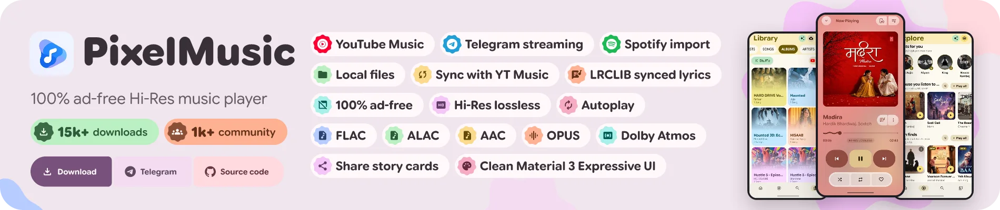
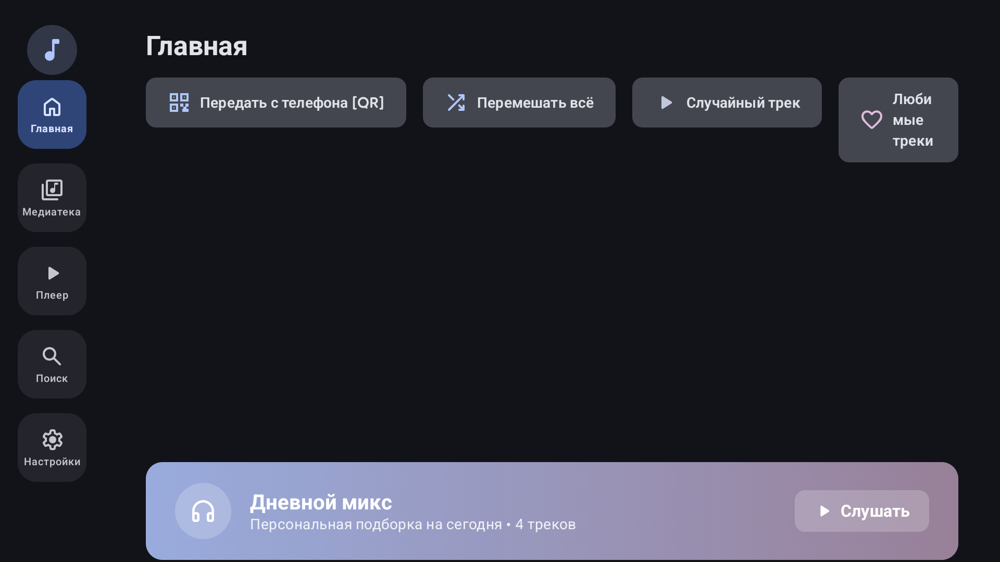
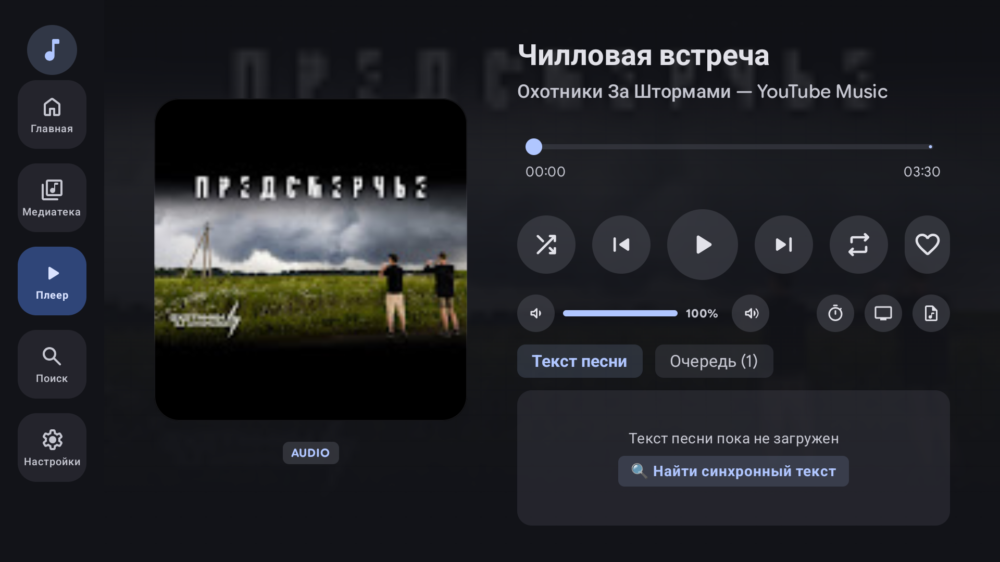
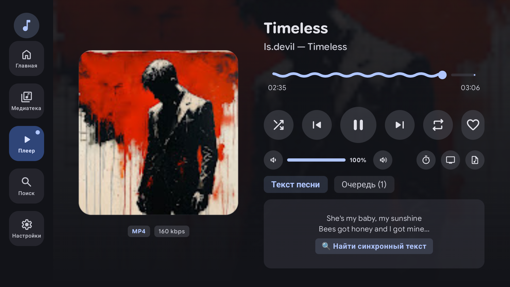
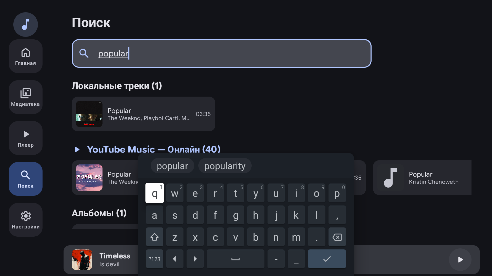
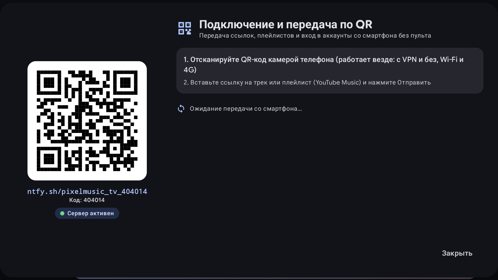
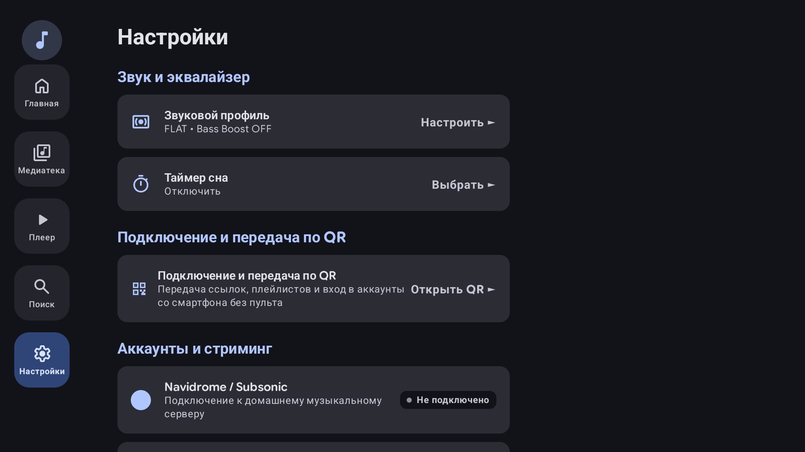
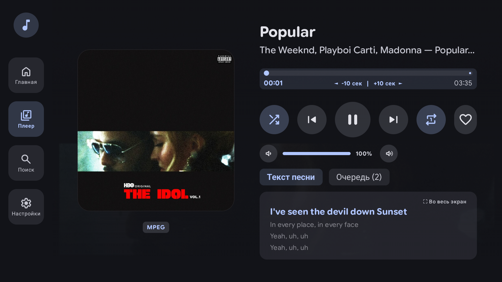

<div align="center">



# 📺 PixelMusic TV Edition

**🇬🇧 English** | **[🇷🇺 Русский](#-pixelmusic-tv-edition-1)**

---

**A premium open-source music player crafted specifically for Android TV and Google TV.**  
*Full Material 3 Expressive design, ad-free YouTube Music streaming, instant track transfer via QR code from your smartphone, synced karaoke lyrics, and Hi-Res Lossless audio support.*

<br>

<p align="center">
  <a href="https://github.com/Arhetip994/PixelMusic-TV/releases"></a>
  
  
  
  
</p>

</div>

---

## 🌟 Key Features

- 🎮 **True Android TV Leanback Experience**:
  Built from the ground up for D-Pad remotes. Smooth focus transitions, cinematic card scaling, crisp focus rings, and instant responsiveness.
- ⚡ **Ad-Free YouTube Music Online Streaming**:
  Direct playback from the YouTube Music and YouTube catalog with zero ads and no `00:00` freezes, powered by smart BotGuard/PoToken handling and automatic fallback audio stream resolution.
- 📱 **Instant QR Code Transfer**:
  Forget slow typing with a TV remote! Point your smartphone camera at the QR code on your TV screen and send any track or playlist link (YouTube Music / Spotify) straight to the player. Works seamlessly over both LAN and ntfy cloud relay (with or without a VPN).
- 🎤 **Synced Karaoke Lyrics from 5 Providers**:
  Multi-provider time-synced lyrics (LRCLIB, QQ Music, Apple Music via lrc.red, NetEase, KuGou) with real-time line animations.
- 🎨 **Material 3 Expressive & Dynamic Blur**:
  The Now Playing screen dynamically adapts its color palette to the current album artwork with smooth background blur, a Wavy Progress Slider, and a built-in 10-band equalizer.
- 🖼️ **Ultra HD Cover Art**:
  Automatic upscaling of Google User Content album covers up to **1200×1200px** and YouTube thumbnails up to HD **1280×720px**.
- 🎵 **Hi-Res Lossless Audio**:
  Full support for modern audio formats: FLAC, ALAC, WAV, APE, OPUS, MP3, Vorbis, and AAC.

---

## 📸 Screenshots

<div align="center">

### 1. Home Dashboard
*Curated picks, recent tracks, albums, and quick access to your media library*


---

### 2. Now Playing Screen
*Cinematic player featuring dynamic adaptive blur, Wavy Slider, and full D-Pad remote controls*


---

### 3. Synced Lyrics (Karaoke Mode)
*Interactive lyric view with real-time active line highlighting*


---

### 4. Smart Online & Local Search
*Parallel search across tracks, singles, and music videos with automatic typo correction*


---

### 5. QR Code Connection & Transfer (QR Sync)
*Instantly cast songs and playlists from any smartphone without typing on your TV*


---

### 6. Settings & First-Run Onboarding
*Choose your language (English / Russian), audio engine settings, themes, and display options*

| TV Settings | Welcome Screen (Setup) |
|:---:|:---:|
|  |  |

</div>

---

## 📋 Quick Facts

| Parameter | Details |
|:---|:---|
| **Name** | PixelMusic TV Edition |
| **Repository** | [Arhetip994/PixelMusic-TV](https://github.com/Arhetip994/PixelMusic-TV) |
| **Platform** | Android TV, Google TV, Android 11+ (API 30+) |
| **Controls** | Remote Control (D-Pad: Up, Down, Left, Right, Center, Back) |
| **Audio Sources** | Local Files, YouTube Music, YouTube, Web Streams |
| **Lyrics Providers** | LRCLIB, QQ Music, Apple Music (lrc.red), NetEase, KuGou |
| **Audio Engine** | ExoPlayer / Media3 (Float32, BassBoost, 10-band EQ) |
| **Tech Stack** | Kotlin, Jetpack Compose for TV, Ktor, Hilt, Coroutines |
| **License** | GNU General Public License v3.0 |

---

## 🛠️ Building from Source

To build the project on your local machine:

```bash
# Clone the repository
git clone git@github.com:Arhetip994/PixelMusic-TV.git
cd PixelMusic-TV

# Build universal Debug APK
./gradlew assembleDebug

# Build Release version
./gradlew assembleRelease
```

The compiled APKs will be located in:
`app/build/outputs/apk/debug/`

---

## 📄 License

This project is distributed under the free **GNU General Public License v3.0 (GPLv3)**. See the [LICENSE](LICENSE) file for more details.

<div align="center">
  <sub>Crafted with passion for a comfortable big-screen music experience.</sub>
</div>

<br>

---

<br>

<div align="center">

# 📺 PixelMusic TV Edition

**[🇬🇧 English](#-pixelmusic-tv-edition)** | **🇷🇺 Русский**

---

**Премиальный музыкальный плеер с открытым исходным кодом, созданный специально для Android TV и Google TV.**  
*Полноценный Material 3 Expressive дизайн, онлайн-стриминг YouTube Music без рекламы, передача треков по QR-коду со смартфона, синхронизированные тексты песен и поддержка Hi-Res Lossless аудио.*

</div>

---

## 🌟 Ключевые возможности

- 🎮 **Настоящий Android TV Leanback опыт**:
  Интерфейс спроектирован с нуля под пульты ДУ (D-Pad). Плавный фокус, кинематографические масштабирования карточек, фокусные рамки и мгновенный отклик.
- ⚡ **Онлайн-стриминг YouTube Music без рекламы**:
  Прямое воспроизведение музыки из каталога YouTube Music и YouTube без единой рекламы и без зависаний на 00:00 благодаря интеллектуальному обходу BotGuard/PoToken и автопоиску альтернативных аудиопотоков.
- 📱 **Мгновенная передача по QR-коду**:
  Забудьте о медленном вводе названий с пульта! Наведите камеру смартфона на QR-код на экране ТВ и отправьте ссылку на трек или плейлист (YouTube Music / Spotify) прямо в плеер. Работает через локальную сеть и облачный релей ntfy (с VPN и без него).
- 🎤 **Караоке-тексты песен из 5 источников**:
  Мультипровайдер синхронизированных текстов (LRCLIB, QQ Music, Apple Music via lrc.red, NetEase, KuGou) с анимацией строк в реальном времени.
- 🎨 **Material 3 Expressive & Динамический блюр**:
  Экран плеера плавно окрашивается в цвета обложки текущего трека с динамическим размытием, волнистым ползунком прогресса (Wavy Slider) и поддержкой 10-полосного эквалайзера.
- 🖼️ **Ультра-чёткие обложки (Ultra HD)**:
  Автоматический апскейл альбомных артов Google User Content до **1200x1200px** и YouTube-превью до HD **1280x720px**.
- 🎵 **Hi-Res Lossless аудио**:
  Поддержка всех современных форматов: FLAC, ALAC, WAV, APE, OPUS, MP3, Vorbis, AAC.

---

## 📸 Галерея интерфейса (Screenshots)

<div align="center">

### 1. Главный экран (Home Dashboard)
*Подборки, недавние треки, альбомы и быстрый доступ к медиатеке*


---

### 2. Экран воспроизведения (Now Playing)
*Кинематографический плеер с динамическим адаптивным блюром, Wavy Slider и полным управлением с пульта*


---

### 3. Синхронизированные тексты песен (Karaoke Lyrics)
*Интерактивное отображение текста с подсветкой текущей строки в реальном времени*


---

### 4. Умный поиск онлайн и локально (Smart Search)
*Параллельный поиск треков, синглов и видеоклипов с автоисправлением опечаток*


---

### 5. Подключение и передача по QR-коду (QR Sync)
*Мгновенная отправка песен и плейлистов с любого смартфона без ввода текста на телевизоре*


---

### 6. Настройки и Экран первого запуска (Settings & Onboarding)
*Выбор языка (Русский / English), аудиодвижка, тем оформления и параметров экрана*

| Настройки телевизора | Экран приветствия (Setup) |
|:---:|:---:|
|  |  |

</div>

---

## 📋 Сводная таблица (Quick Facts)

| Параметр | Значение |
|:---|:---|
| **Название** | PixelMusic TV Edition |
| **Репозиторий** | [Arhetip994/PixelMusic-TV](https://github.com/Arhetip994/PixelMusic-TV) |
| **Платформа** | Android TV, Google TV, Android 11+ (API 30+) |
| **Управление** | Пульт ДУ (D-pad: Up, Down, Left, Right, Center, Back) |
| **Источники аудио** | Локальные файлы, YouTube Music, YouTube, Web Streams |
| **Провайдеры текстов** | LRCLIB, QQ Music, Apple Music (lrc.red), NetEase, KuGou |
| **Аудиодвижок** | ExoPlayer / Media3 (Float32, BassBoost, 10-band EQ) |
| **Стек** | Kotlin, Jetpack Compose for TV, Ktor, Hilt, Coroutines |
| **Лицензия** | GNU General Public License v3.0 |

---

## 🛠️ Сборка из исходников

Для сборки проекта на локальной машине:

```bash
# Клонирование репозитория
git clone git@github.com:Arhetip994/PixelMusic-TV.git
cd PixelMusic-TV

# Сборка универсального Debug APK
./gradlew assembleDebug

# Сборка Release версии
./gradlew assembleRelease
```

Собранные APK будут находиться в директории:
`app/build/outputs/apk/debug/`

---

## 📄 Лицензия

Проект распространяется под свободной лицензией **GNU General Public License v3.0 (GPLv3)**. Подробнее см. в файле [LICENSE](LICENSE).

<div align="center">
  <sub>Создано с душой для комфортного прослушивания музыки на большом экране.</sub>
</div>