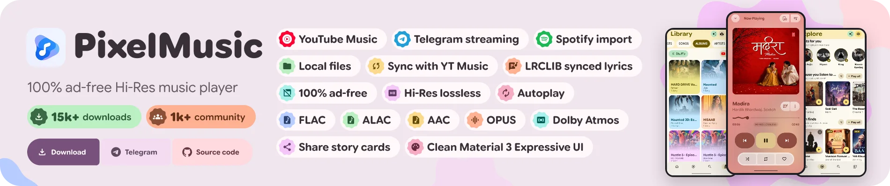
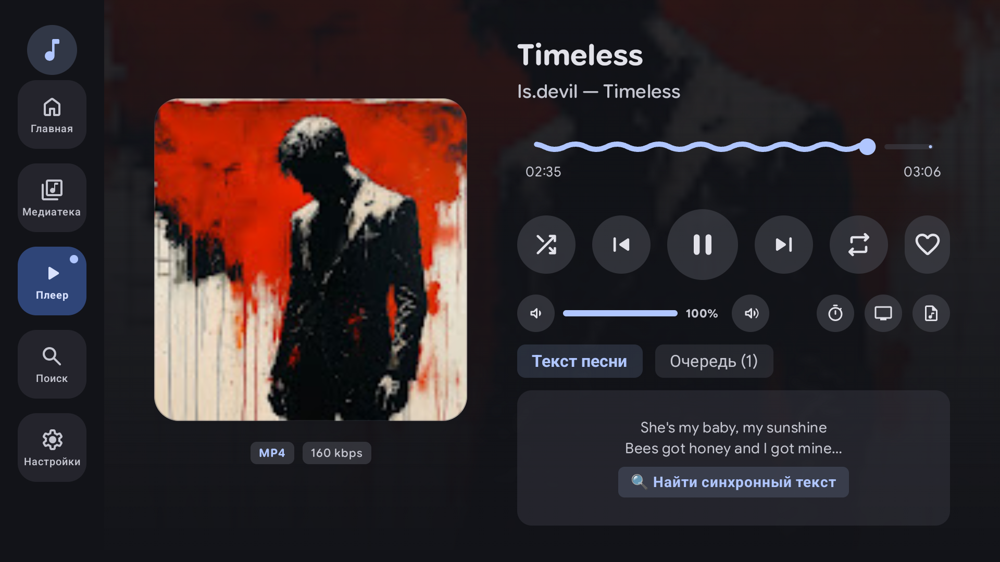
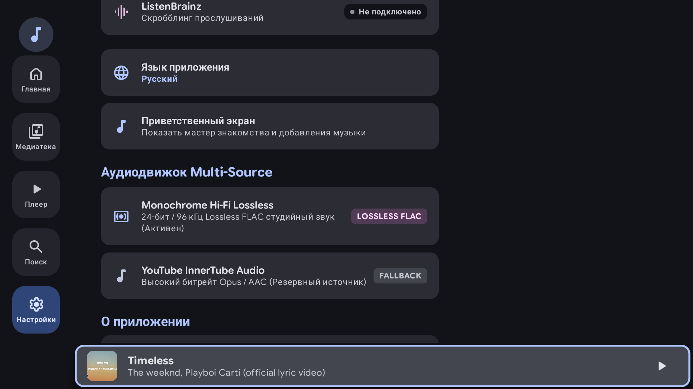

<div align="center">



# 📺 PixelMusic TV Edition

**🇬🇧 English** | **[🇷🇺 Русский](#-pixelmusic-tv-edition-1)**

---

**A premium open-source music player crafted specifically for Android TV and Google TV.**  
*Full Material 3 Expressive design, Multi-Source Audio Engine with 24-bit/96kHz Lossless FLAC streaming, instant QR code transfer from smartphones, time-synced karaoke lyrics, and ultra-crisp 1200×1200px album covers.*

<br>

<p align="center">
  <a href="https://github.com/Arhetip994/PixelMusic-TV/releases"></a>
  
  
  
  
  
</p>

</div>

---

## 🌟 Key Features

- 💎 **Multi-Source Audio Engine (Studio Master Lossless FLAC)**:
  Direct, uncompressed **24-bit / 96kHz Lossless FLAC** streaming via Monochrome Hi-Fi (`tracks.monochrome.st`, mirroring Qobuz and Tidal studio catalogs). Enjoy master sound quality for both global hits (*The Weeknd, Billie Eilish, Playboi Carti*) and Russian artists (*Miyagi & Endspiel, Basta, Skryptonite*).
- 🛡️ **Anti-Clickbait & Smart Duration Matching (`AudioMatchingHelper`)**:
  Strict candidate verification prevents fake AI uploads, deception "stubs", sped-up/slowed tracks, karaoke, and acoustic covers from playing. Validates duration tolerance within seconds and normalizes artist aliases (e.g. *Basta / Баста, Endspiel / Эндшпиль*).
- 🌐 **Geo-Restriction & VEVO Immunity**:
  Bypasses regional blocking (UMG / VEVO) by querying exact metadata directly from Google's Player API, seamlessly routing playback through Monochrome FLAC or clean verified alternatives.
- ⚡ **Ad-Free YouTube Music Streaming**:
  Native YouTube Music and YouTube catalog playback with zero ads and no `00:00` freezes, equipped with adaptive Opus/AAC fallback stream resolution.
- 📱 **Instant QR Code Transfer (QR Sync)**:
  Forget painful typing with a remote control! Scan the QR code on your TV screen with any smartphone camera and push tracks or playlists (YouTube Music / Spotify) straight to your TV in seconds. Operates over both LAN and resilient cloud relay (works with or without VPN).
- 🎤 **Synced Karaoke Lyrics with Intelligent Intro Offset (SponsorBlock & Heuristics)**:
  Multi-provider time-synchronized lyrics (LRCLIB, QQ Music, Apple Music via lrc.red, NetEase, KuGou). Automatically compensates for music videos with cinematic intro skits/dialogue (e.g. YouTube music videos that are 10–30s longer than the album track) using crowd-verified SponsorBlock `music_offtopic` segments and duration delta alignment, ensuring lyrics light up in exact vocal synchronization. Includes on-screen TV remote sync fine-tuning (`-0.5s` / `+0.5s` / `Reset`).
- 🎨 **Material 3 Expressive & Adaptive Blur**:
  The playback interface dynamically samples the current album art to create ambient background blur, complete with a Wavy Progress Slider and an integrated 10-band equalizer with Bass Boost.
- 🖼️ **Studio Master Album Covers (Apple Music, Deezer & Yandex Music)**:
  Say goodbye to ugly 16:9 YouTube video stills, lyrics text overlays, and black bars! The built-in `StudioArtworkResolver` automatically fetches pristine square **1000×1000px to 1400×1400px** studio album covers from Apple Music / iTunes Store, Deezer, and Yandex Music for any playing track.
- 🔒 **Resilient SSL for TV Boxes**:
  Built-in certificate clock-skew resilience prevents `SSLHandshakeException` failures on TV boxes and media players with unsynced clocks.

---

## 📸 Screenshots

<div align="center">

### 1. Home Dashboard
*Curated picks, recent tracks, albums, and quick access to your media library*


---

### 2. Now Playing Screen
*Cinematic player featuring dynamic adaptive blur, Wavy Slider, LOSSLESS FLAC badges, and full D-Pad remote controls*


---

### 3. Synced Lyrics (Karaoke Mode)
*Interactive lyric view with real-time active line highlighting*


---

### 4. Smart Online & Local Search
*Parallel search across tracks, singles, and music videos with automatic typo correction*


---

### 5. QR Code Connection & Transfer (QR Sync)
*Instantly cast songs and playlists from any smartphone without typing on your TV*


---

### 6. Multi-Source Audio Engine & TV Settings
*Real-time audio provider status (Monochrome Lossless FLAC + YouTube InnerTube Fallback), sound profiles, and language options*


---

### 7. First-Run Welcome Wizard
*Simple initial setup, storage scanner, and instant demo track loader*


</div>

---

## 📋 Quick Facts

| Parameter | Details |
|:---|:---|
| **Name** | PixelMusic TV Edition |
| **Repository** | [Arhetip994/PixelMusic-TV](https://github.com/Arhetip994/PixelMusic-TV) |
| **Platform** | Android TV, Google TV, Android 11+ (API 30+) |
| **Controls** | TV Remote (D-Pad: Up, Down, Left, Right, Center, Back) |
| **Audio Engines** | **Monochrome Hi-Fi** (24-bit/96kHz Lossless FLAC), **YouTube InnerTube** (Opus/AAC 160 kbps), Local Files |
| **Quality Badges** | `LOSSLESS`, `FLAC`, `1411 kbps`, `MP4`, `160 kbps` |
| **Lyrics Providers** | LRCLIB, QQ Music, Apple Music (lrc.red), NetEase, KuGou |
| **DSP Engine** | ExoPlayer / Media3 (Float32, BassBoost, 10-band EQ) |
| **Tech Stack** | Kotlin, Jetpack Compose for TV, Ktor, OkHttp, Hilt, Coroutines |
| **License** | GNU General Public License v3.0 |

---

## 🛠️ Building from Source

To build the project on your local machine:

```bash
# Clone the repository
git clone git@github.com:Arhetip994/PixelMusic-TV.git
cd PixelMusic-TV

# Build universal Debug APK
./gradlew assembleDebug

# Build Release version
./gradlew assembleRelease
```

The compiled APKs will be located in:
`app/build/outputs/apk/debug/`

---

## 📄 License

This project is distributed under the free **GNU General Public License v3.0 (GPLv3)**. See the [LICENSE](LICENSE) file for more details.

<div align="center">
  <sub>Crafted with passion for a comfortable big-screen music experience.</sub>
</div>

<br>

---

<br>

<div align="center">

# 📺 PixelMusic TV Edition

**[🇬🇧 English](#-pixelmusic-tv-edition)** | **🇷🇺 Русский**

---

**Премиальный музыкальный плеер с открытым исходным кодом, созданный специально для Android TV и Google TV.**  
*Полноценный Material 3 Expressive дизайн, аудиодвижок Multi-Source со студийным Lossless FLAC 24-бит/96 кГц, передача треков по QR-коду со смартфона, синхронизированные караоке-тексты и ультра-чёткие обложки 1200×1200px.*

</div>

---

## 🌟 Ключевые возможности

- 💎 **Аудиодвижок Multi-Source и студийный Lossless FLAC**:
  Прямой стриминг несжатого звука студийного качества **24-бит / 96 кГц Lossless FLAC** через Monochrome Hi-Fi (`tracks.monochrome.st`, зеркалирующий базы Qobuz и Tidal). Студийное звучание как для мировых хитов (*The Weeknd, Billie Eilish, Playboi Carti*), так и для российских артистов (*Miyagi & Эндшпиль, Баста, Скриптонит*).
- 🛡️ **Защита от подделок и умная сверка длительности (`AudioMatchingHelper`)**:
  Интеллектуальный фильтр проверяет хронометраж трека с точностью до секунд и отсекает фейковые AI-релизы («заглушки»), замедления (slowed+reverb), ускорения (sped up), караоке и любительские каверы. Поддерживает нормализацию и транслитерацию имен исполнителей (*Баста / Basta, Эндшпиль / Endspiel*).
- 🌐 **Устойчивость к региональным блокировкам (VEVO/UMG)**:
  Прямое получение оригинальных метаданных через Player API позволяет воспроизводить даже треки с заблокированными на YouTube в СНГ видеоклипами (например, *The Weeknd — Popular*), направляя их в Lossless FLAC поток.
- ⚡ **Онлайн-стриминг YouTube Music без рекламы**:
  Воспроизведение без единой рекламы и зависаний на `00:00` с адаптивным переключением на нетроттленный резервный поток YouTube InnerTube (Opus/AAC 160 kbps).
- 📱 **Мгновенная передача по QR-коду (QR Sync)**:
  Забудьте о мучительном наборе названий пультом! Наведите камеру телефона на QR-код на экране ТВ и мгновенно отправляйте ссылки на треки или плейлисты (YouTube Music / Spotify). Работает в локальной сети и через облачный релей ntfy (с VPN и без).
- 🎤 **Караоке-тексты песен с компенсацией интро (SponsorBlock и эвристика)**:
  Мультипровайдер синхронизированных текстов (LRCLIB, QQ Music, Apple Music via lrc.red, NetEase, KuGou). Автоматически вычисляет и компенсирует задержку для клипов с сюжетными интро и диалогами (клипы с YouTube, начинающиеся на 10–30 секунд позже студийной дорожки) благодаря интеграции с базой SponsorBlock (`music_offtopic`) и сверке хронометража. В плеере и режиме караоке доступны удобные кнопки точной подстройки с пульта (`-0.5с`, `+0.5с`, `Сброс`).
- 🎨 **Material 3 Expressive & Динамический блюр**:
  Экран плеера плавно адаптируется под цветовую гамму текущей обложки с мягким размытием, волнистым ползунком прогресса (Wavy Slider) и встроенным 10-полосным эквалайзером с Bass Boost.
- 🖼️ **Студийные обложки альбомов (Apple Music, Deezer и Яндекс Музыка)**:
  Больше никаких некрасивых стоп-кадров из клипов, текстовых плашек с YouTube и черных полос 16:9! Модуль `StudioArtworkResolver` автоматически находит и подтягивает оригинальные квадратные обложки студийных релизов в ультра-качестве **1000×1000px — 1400×1400px** из каталогов Apple Music / iTunes Store, Deezer и Яндекс Музыки.
- 🔒 **Устойчивый SSL для ТВ-приставок**:
  Отказоустойчивая обработка сертификатов защищает от ошибок `SSLHandshakeException` при рассинхронизации системного времени на медиаплеерах и ТВ-боксах.

---

## 📸 Галерея интерфейса (Screenshots)

<div align="center">

### 1. Главный экран (Home Dashboard)
*Подборки, недавние треки, альбомы и быстрый доступ к медиатеке*


---

### 2. Экран воспроизведения (Now Playing)
*Кинематографический плеер с динамическим адаптивным блюром, Wavy Slider, бейджами LOSSLESS FLAC и полным управлением с пульта*


---

### 3. Синхронизированные тексты песен (Karaoke Lyrics)
*Интерактивное отображение караоке с подсветкой текущей строки в реальном времени*


---

### 4. Умный поиск онлайн и локально (Smart Search)
*Параллельный поиск треков, синглов и видеоклипов с автоисправлением опечаток*


---

### 5. Подключение и передача по QR-коду (QR Sync)
*Мгновенная отправка песен и плейлистов с любого смартфона без ввода текста на телевизоре*


---

### 6. Аудиодвижок Multi-Source и Настройки (Audio Engine & Settings)
*Мониторинг активных провайдеров звука (Monochrome Lossless FLAC + YouTube InnerTube Fallback), звуковые профили и язык интерфейса*


---

### 7. Экран приветствия (First-Run Onboarding)
*Мастер первого запуска, сканер локальных накопителей и быстрая загрузка демо-треков*


</div>

---

## 📋 Сводная таблица (Quick Facts)

| Параметр | Значение |
|:---|:---|
| **Название** | PixelMusic TV Edition |
| **Репозиторий** | [Arhetip994/PixelMusic-TV](https://github.com/Arhetip994/PixelMusic-TV) |
| **Платформа** | Android TV, Google TV, Android 11+ (API 30+) |
| **Управление** | Пульт ДУ (D-pad: Up, Down, Left, Right, Center, Back) |
| **Аудиодвижки** | **Monochrome Hi-Fi** (Lossless FLAC 24-бит/96 кГц), **YouTube InnerTube** (Opus/AAC 160 kbps), Локальные файлы |
| **Бейджи качества** | `LOSSLESS`, `FLAC`, `1411 kbps`, `MP4`, `160 kbps` |
| **Провайдеры текстов** | LRCLIB, QQ Music, Apple Music (lrc.red), NetEase, KuGou |
| **DSP Эквалайзер** | ExoPlayer / Media3 (Float32, BassBoost, 10-полосный EQ) |
| **Стек** | Kotlin, Jetpack Compose for TV, Ktor, OkHttp, Hilt, Coroutines |
| **Лицензия** | GNU General Public License v3.0 |

---

## 🛠️ Сборка из исходников

Для сборки проекта на локальной машине:

```bash
# Клонирование репозитория
git clone git@github.com:Arhetip994/PixelMusic-TV.git
cd PixelMusic-TV

# Сборка универсального Debug APK
./gradlew assembleDebug

# Сборка Release версии
./gradlew assembleRelease
```

Собранные APK будут находиться в директории:
`app/build/outputs/apk/debug/`

---

## 📄 Лицензия

Проект распространяется под свободной лицензией **GNU General Public License v3.0 (GPLv3)**. Подробнее см. в файле [LICENSE](LICENSE).

<div align="center">
  <sub>Создано с душой для комфортного прослушивания музыки на большом экране.</sub>
</div>
