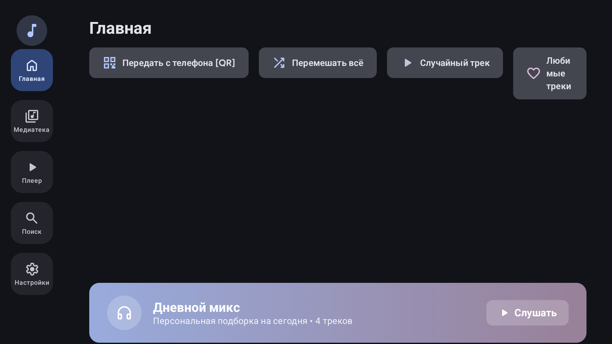
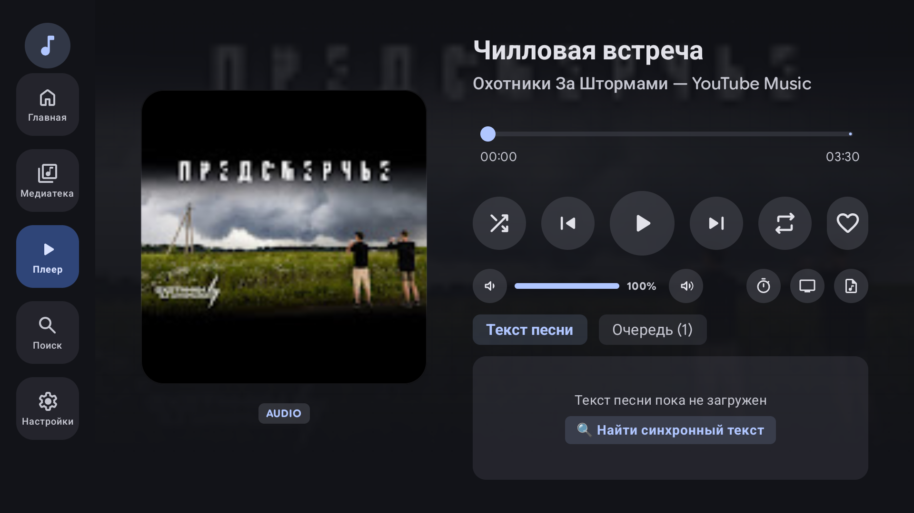
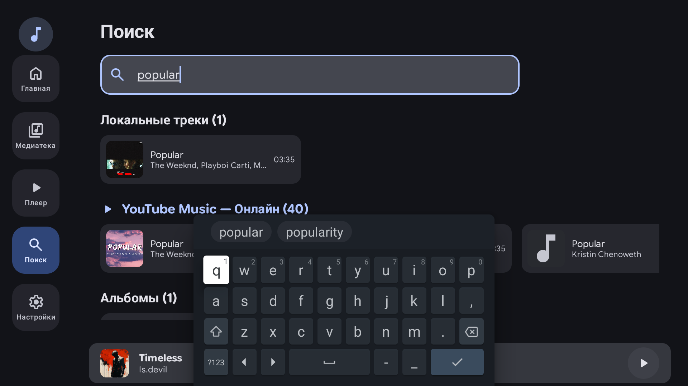
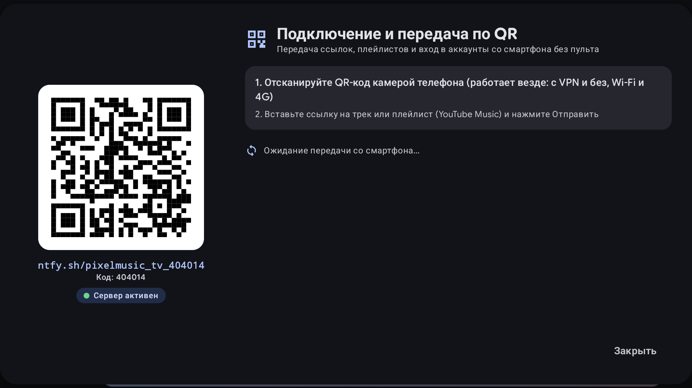
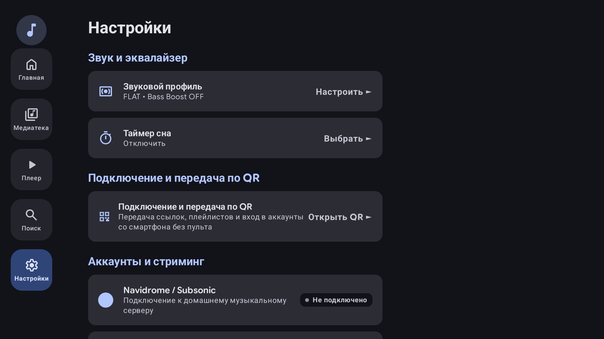
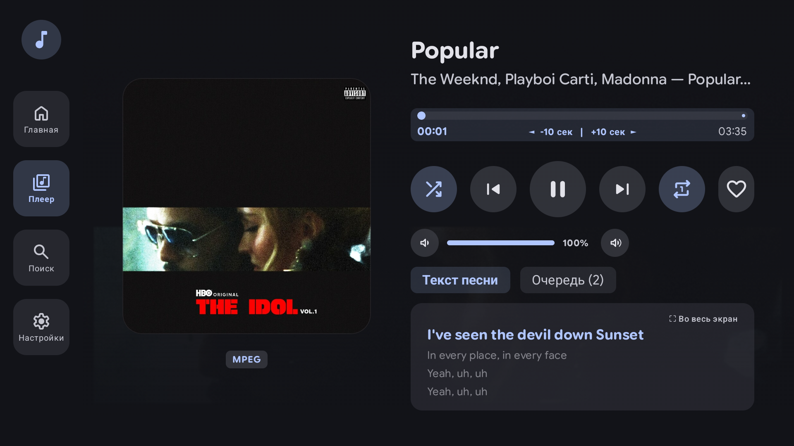

<div align="center">


# 📺 PixelMusic TV Edition

**Премиальный музыкальный плеер с открытым исходным кодом, созданный специально для Android TV и Google TV.**  
*Полноценный Material 3 Expressive дизайн, онлайн-стриминг YouTube Music без рекламы, передача треков по QR-коду со смартфона, синхронизированные тексты песен и поддержка Hi-Res Lossless аудио.*

<br>

<p align="center">
  <a href="https://github.com/Arhetip994/PixelMusic-TV/releases"></a>
  
  
  
  
</p>

</div>

---

## 🌟 Ключевые возможности

- 🎮 **Настоящий Android TV Leanback опыт**:
  Интерфейс спроектирован с нуля под пульты ДУ (D-Pad). Плавный фокус, кинематографические масштабирования карточек, фокусные рамки и мгновенный отклик.
- ⚡ **Онлайн-стриминг YouTube Music без рекламы**:
  Прямое воспроизведение музыки из каталога YouTube Music и YouTube без единой рекламы и без зависаний на 00:00 благодаря интеллектуальному обходу BotGuard/PoToken и автопоиску альтернативных аудиопотоков.
- 📱 **Мгновенная передача по QR-коду**:
  Забудьте о медленном вводе названий с пульта! Наведите камеру смартфона на QR-код на экране ТВ и отправьте ссылку на трек или плейлист (YouTube Music / Spotify) прямо в плеер. Работает через локальную сеть и облачный релей ntfy (с VPN и без него).
- 🎤 **Караоке-тексты песен из 5 источников**:
  Мультипровайдер синхронизированных текстов (LRCLIB, QQ Music, Apple Music via lrc.red, NetEase, KuGou) с анимацией строк в реальном времени.
- 🎨 **Material 3 Expressive & Динамический блюр**:
  Экран плеера плавно окрашивается в цвета обложки текущего трека с динамическим размытием, волнистым ползунком прогресса (Wavy Slider) и поддержкой 10-полосного эквалайзера.
- 🖼️ **Ультра-чёткие обложки (Ultra HD)**:
  Автоматический апскейл альбомных артов Google User Content до **1200x1200px** и YouTube-превью до HD **1280x720px**.
- 🎵 **Hi-Res Lossless аудио**:
  Поддержка всех современных форматов: FLAC, ALAC, WAV, APE, OPUS, MP3, Vorbis, AAC.

---

## 📸 Галерея интерфейса (Screenshots)

<div align="center">

### 1. Главный экран (Home Dashboard)
*Подборки, недавние треки, альбомы и быстрый доступ к медиатеке*


---

### 2. Экран воспроизведения (Now Playing)
*Кинематографический плеер с динамическим адаптивным блюром, Wavy Slider и полным управлением с пульта*


---

### 3. Синхронизированные тексты песен (Karaoke Lyrics)
*Интерактивное отображение текста с подсветкой текущей строки в реальном времени*


---

### 4. Умный поиск онлайн и локально (Smart Search)
*Параллельный поиск треков, синглов и видеоклипов с автоисправлением опечаток*


---

### 5. Подключение и передача по QR-коду (QR Sync)
*Мгновенная отправка песен и плейлистов с любого смартфона без ввода текста на телевизоре*


---

### 6. Настройки и Экран первого запуска (Settings & Onboarding)
*Выбор языка (Русский / English), аудиодвижка, тем оформления и параметров экрана*

| Настройки телевизора | Экран приветствия (Setup) |
|:---:|:---:|
|  |  |

</div>

---

## 📋 Сводная таблица (Quick Facts)

| Параметр | Значение |
|:---|:---|
| **Название** | PixelMusic TV Edition |
| **Репозиторий** | [Arhetip994/PixelMusic-TV](https://github.com/Arhetip994/PixelMusic-TV) |
| **Платформа** | Android TV, Google TV, Android 11+ (API 30+) |
| **Управление** | Пульт ДУ (D-pad: Up, Down, Left, Right, Center, Back) |
| **Источники аудио** | Локальные файлы, YouTube Music, YouTube, Web Streams |
| **Провайдеры текстов** | LRCLIB, QQ Music, Apple Music (lrc.red), NetEase, KuGou |
| **Аудиодвижок** | ExoPlayer / Media3 (Float32, BassBoost, 10-band EQ) |
| **Стек** | Kotlin, Jetpack Compose for TV, Ktor, Hilt, Coroutines |
| **Лицензия** | GNU General Public License v3.0 |

---

## 🛠️ Сборка из исходников

Для сборки проекта на локальной машине:

```bash
# Клонирование репозитория
git clone git@github.com:Arhetip994/PixelMusic-TV.git
cd PixelMusic-TV

# Сборка универсального Debug APK
./gradlew assembleDebug

# Сборка Release версии
./gradlew assembleRelease
```

Собранные APK будут находиться в директории:
`app/build/outputs/apk/debug/`

---

## 📄 Лицензия

Проект распространяется под свободной лицензией **GNU General Public License v3.0 (GPLv3)**. Подробнее см. в файле [LICENSE](LICENSE).

<div align="center">
  <sub>Создано с душой для комфортного прослушивания музыки на большом экране.</sub>
</div>
